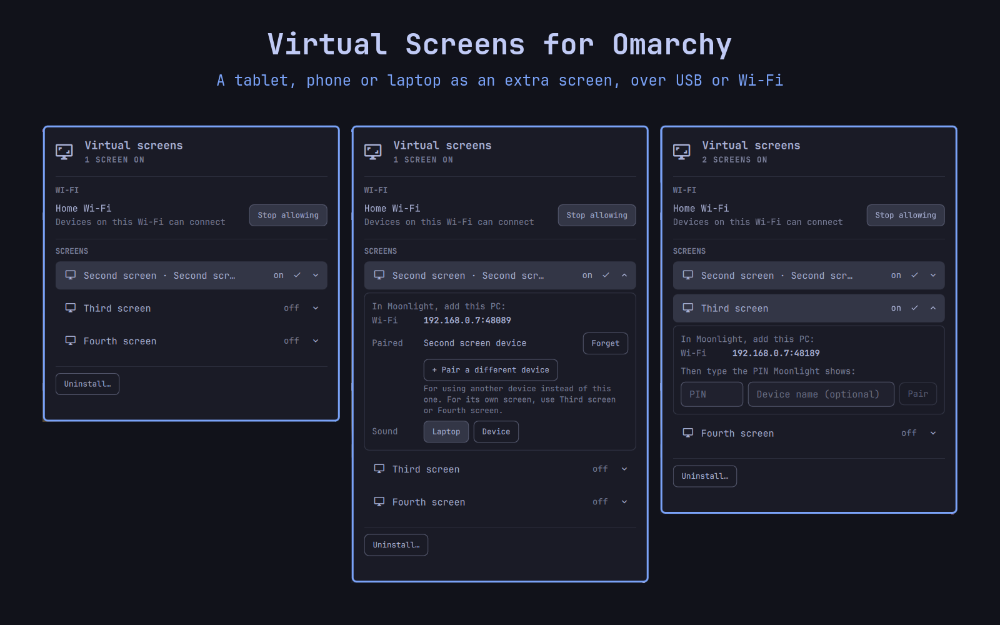
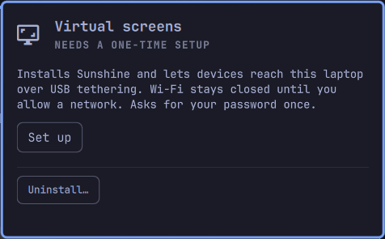
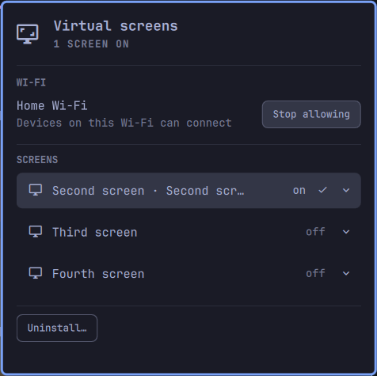
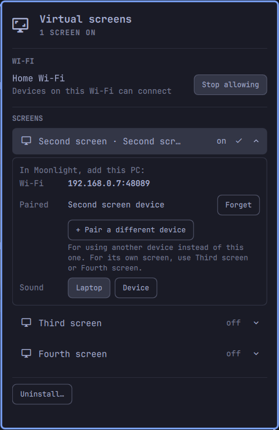
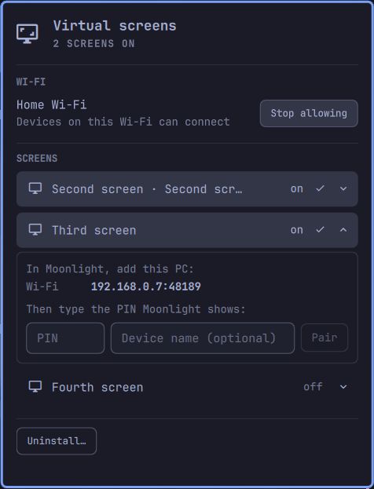
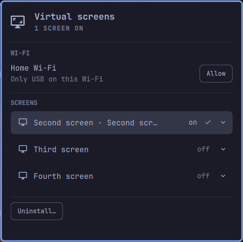
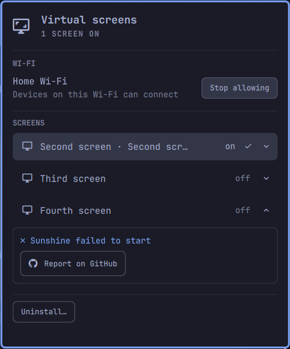
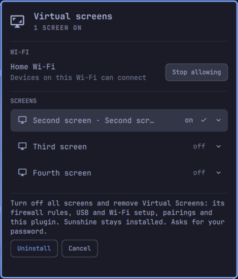

# Virtual Screens for Omarchy

Use a tablet, phone or another laptop as an extra screen for [Omarchy](https://omarchy.org), over a USB cable or your home Wi-Fi.

Each extra screen is a virtual monitor in Hyprland, streamed to the device with [Sunshine](https://github.com/LizardByte/Sunshine) and shown there in [Moonlight](https://moonlight-stream.org). Windows can be moved onto it like on any other monitor.

Everything happens in the bar panel: setup, turning screens on and off, pairing with a PIN and choosing where sound plays. You never need Sunshine's web page.



## Install

```bash
omarchy plugin add https://github.com/jebin2/omarchy-virtual-screens.git --enable
omarchy restart shell
```

A screen icon (󰹑) appears in the bar. Then:

1. Click it and press **Set up**. It asks for your password once, installs Sunshine and lets devices connect over USB tethering.
2. To use Wi-Fi, press **Allow** next to your home network. Wi-Fi stays closed everywhere else.
3. Click **Second screen** to turn it on. The panel shows the address to use.
4. On the device, install Moonlight, add the PC with that address (for example `192.168.0.7:48089`), and tap it.
5. Moonlight shows a 4-digit PIN. Type it into the panel and press **Pair**.
6. In Moonlight, open **Desktop**.

The virtual screen resizes itself to the device's resolution when it connects. Next time you only need steps 3 and 6.

## What you can do in the panel

| | |
|---|---|
| **Second / Third / Fourth screen** | Click to turn on or off. Each screen is a separate desktop on its own device. |
| **▾ arrow** | Shows the screen's addresses, paired devices (with **Forget**) and the sound setting. |
| **Pair a different device** | Trust another device for the same screen, to use it *instead of* the first one. For a second picture, use another screen. |
| **Sound: Laptop / Device** | Where that screen's sound plays. Switching restarts the stream, so reconnect in Moonlight. |
| **Wi-Fi: Allow / Stop allowing** | Let devices on this Wi-Fi connect. Remembered per network. |
| **Report on GitHub** | Shown when something fails. Opens a pre-filled issue in your browser for you to review and send. |
| **Update** | Shown after a plugin update that changes the system part. One password prompt. |
| **Uninstall…** | Removes everything, see below. |

## Screenshots

| | | |
|---|---|---|
| <br>**First run:** one Set up button | <br>**Overview:** one screen on, Wi-Fi allowed | <br>**▾ Details:** address, paired device, sound |
| <br>**New device:** type Moonlight's PIN | <br>**Other Wi-Fi:** USB only until you allow it | <br>**Something failed:** report it on GitHub |
| <br>**Uninstall:** everything in one step | | |

## How it works

| Part | What it does |
|---|---|
| `bin/virtual-screen` | Runs as you. Creates the virtual monitor `SCREEN-N`, writes its Sunshine config, starts and stops Sunshine, pairs devices through Sunshine's local API, and resizes the screen when a device connects. |
| `bin/virtual-screen-root` | Runs as root, only from **Set up** and the Wi-Fi buttons, through `pkexec`. Installs the system pieces below. Setup copies it to `/usr/local/libexec/omarchy-virtual-screens-root` (root-owned), and later prompts use that copy. |
| `system/70-omarchy-virtual-screens.rules` | Names Android USB tethering links (RNDIS) `tether0`, `tether1`… so the firewall can allow exactly those. |
| `system/90-omarchy-virtual-screens` | NetworkManager script: opens Sunshine's ports on Wi-Fi only while you're on an allowed network, only for its own subnet, and closes them everywhere else. |
| NetworkManager profile "Virtual screens USB" | USB tethering links never become your internet connection or DNS. |

Each screen has its own Sunshine instance, config and pairings:

| Screen | Config | Ports |
|---|---|---|
| Second | `~/.config/virtual-screens/screen-2/` | 48084–48110 |
| Third | `~/.config/virtual-screens/screen-3/` | 48184–48210 |
| Fourth | `~/.config/virtual-screens/screen-4/` | 48284–48310 |

These aren't Sunshine's default ports, so a normal Sunshine install (for game streaming, say) keeps working beside it.

A random login for Sunshine's API is generated once and kept in `~/.config/virtual-screens/login` (only readable by you). Settings of your own for every instance go in `~/.config/virtual-screens/sunshine-extra.conf`.

## Security

- Sunshine is reachable only over USB tethering links and Wi-Fi networks you allowed, and only from that network's own address range. Its admin page and API answer on this laptop only.
- New devices need a PIN that you type in on the laptop.
- The generated Sunshine login is kept only in files readable by you and is written straight into each instance's state file, so it never appears in a process's command line, where other accounts on this laptop could read it.
- The login is only ever sent to the instance's own Sunshine: requests to its local API are pinned to the public key of that instance's certificate (kept in your config dir), so another account that takes the API port first gets no connection and never sees the login.
- The panel never runs a root command without the password prompt. After setup, the root helper runs from a root-owned copy, not from your plugin folder.
- With `ufw` inactive, Omarchy's firewall isn't in the way and these rules aren't added.

## Requirements

- Omarchy with the shell plugin system (`omarchy plugin add`).
- A GPU with a hardware video encoder: Intel or AMD (VA-API), or NVIDIA (NVENC). It's detected automatically.
- Moonlight on each device. Android and most others can use USB tethering; iPhones and iPads connect over Wi-Fi.

## Uninstall

In the panel, press **Uninstall…** and confirm. Or in a terminal:

```bash
bash ~/.config/omarchy/plugins/jebin2.virtual-screens/bin/virtual-screen uninstall
```

Either way it asks for your password once, then turns off all screens and removes the firewall rules, USB naming, Wi-Fi script, NetworkManager profile, your configs, pairings and login, and the plugin itself.

If you already ran `omarchy plugin remove jebin2.virtual-screens` (which only deletes the plugin folder), clean up the rest with:

```bash
pkexec /usr/local/libexec/omarchy-virtual-screens-root uninstall
```

Sunshine itself stays installed (`omarchy pkg drop sunshine` removes it).

## Troubleshooting

- **The icon is missing or misplaced after an update:** run `omarchy restart shell`.
- **Moonlight can't find the PC:** add it by the address the panel shows, including the `:port`.
- **No USB address although tethering is on:** turn tethering off and on once (a phone that was already plugged in during setup keeps its old link name until it reconnects).
- **A phone that tethers with NCM (some newer Pixels) gets no USB address:** NCM is left out on purpose, because USB-C docks use the same driver for their Ethernet. Use Wi-Fi, or add `cdc_ncm` to the rule in `/etc/udev/rules.d/70-omarchy-virtual-screens.rules` if you never use such a dock.
- **"Moonlight isn't waiting for a PIN":** in Moonlight tap the PC first, then type the PIN it shows within a minute.
- **Logs:** `~/.config/virtual-screens/screen-N/sunshine.log`.
- **Anything else:** use **Report on GitHub** in the panel, or [open an issue](https://github.com/jebin2/omarchy-virtual-screens/issues).

## Credits

- [Sunshine](https://github.com/LizardByte/Sunshine) by LizardByte (GPL-3.0): the streaming host this plugin drives.
- [Moonlight](https://moonlight-stream.org) (GPL-3.0): the client on each device.
- [Hyprland](https://hypr.land) headless outputs make the virtual screens possible.
- [Omarchy](https://omarchy.org) and its shell plugin system.
- Built with [Claude Code](https://claude.com/claude-code).

## License

MIT
